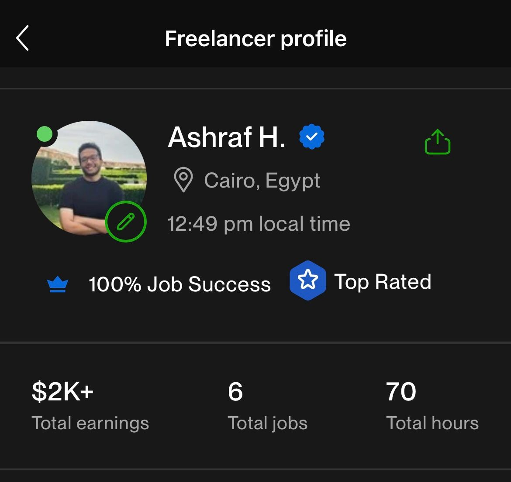

Between August 2024 and May 2026 I worked as a freelance data analyst on Upwork, mostly making scientific animations and doing machine learning research for clients, while I was still a student and later a teaching assistant. By the end, my profile had the **Top Rated** badge and a **100% Job Success Score**, from just six jobs. This post is about how that happened, what the work actually looked like, and what I would tell any student thinking about freelancing.

## Why I started

By the end of 2023 I had already freelanced a little as a full-stack developer, but that market is crowded. Thousands of profiles offer the same thing, and as a student with no reviews, I had nothing that made me stand out.

What I did have was a strange, specific skill. In late 2023 I had spent around 78 hours teaching myself [Manim](/blog/math-animations/) to animate the Distribution Counting Sort algorithm for a course, followed by a second video on neural networks and activation functions. In 2024 I had also been working with quantum machine learning, which ended with my team placing second at [Egypt's first Quantum-AI Hackathon](/blog/nus-quantum-ai-hackathon/).

[TODO: one or two sentences on what pushed you to open the Upwork profile in August 2024. Money for university, wanting real clients, a friend's advice?]

## Picking a niche instead of a job title

The best decision I made was to stop presenting myself as "a developer" and start presenting myself as someone who solves a narrow set of problems well:

- **Educational and scientific animations in Manim.** Very few freelancers know Manim, and the people who need it (educators, researchers, course creators) usually cannot do it themselves.
- **Machine learning and quantum machine learning research.** Implementing and evaluating models from papers, running experiments, and reporting results clearly.
- **Data collection and preprocessing.** Collecting, cleaning and structuring data from messy sources into datasets someone can actually train on.

A narrow niche means fewer jobs to apply to, but far less competition on each one, and clients who are relieved to find you at all.

## The first job is the hardest

[TODO: describe your first Upwork job. What was it, how did you land it, what did you charge, and what went right or wrong? This is the part readers will remember most.]

With no reviews, the only thing a client can judge you on is your proposal and your portfolio. My portfolio was simply the work I had already done for university: the Manim videos on YouTube, the source code on GitHub, and write-ups like the ones on this blog. A proposal that links to a finished animation says more than any paragraph about being "passionate and hard-working".

## What the work actually looked like

[TODO: two or three representative projects, keeping client details anonymous. For example: "an animation explaining X for an online course", "reproducing the results of a QML paper for a researcher", "cleaning and merging N data sources into one dataset".]

Most projects followed the same shape. First, understand what the client actually needs, which is often different from what the job post says. Then agree on a small first deliverable, iterate quickly, and hand over something they can use without me.

## How the Top Rated badge happens

My profile shows six jobs and 70 logged hours. That is not a lot. Plenty of freelancers have hundreds of jobs and no badge. Upwork awards Top Rated based on your track record: above all, how satisfied your clients are (your Job Success Score), along with consistent work and a clean account history. Volume helps far less than people think. Six clients who would all hire you again count for more than sixty who were merely fine.

There is no trick to it. A 100% Job Success Score is the side effect of a lot of small, boring things done consistently:

- **Scope before you start.** Most bad reviews come from mismatched expectations, not bad work. Write down exactly what will be delivered and when.
- **Communicate before you are asked.** A short update when something takes longer than planned builds more trust than delivering silently on time.
- **Deliver something early.** A rough first version in the first days catches misunderstandings while they are still cheap to fix.
- **Make the handover complete.** Clean code, a short README, the rendered video *and* the source. Clients come back to people who are easy to work with.
- **Say no to jobs outside your niche.** One unhappy client on a job you should not have taken costs more than the job pays.

[TODO: roughly when did you get the badge (after which job?), and did anything change afterwards, such as more invitations or higher rates?]

## Balancing it with university and teaching

[TODO: how you fit freelancing around your final year, graduation and the TA job. What did a typical week look like, and what did you have to give up?]

## What freelancing gave me

I stopped freelancing in May 2026 when I joined Techlabs London full-time, and later EY. Looking back, the money mattered less than the habits. Translating a vague request into a concrete deliverable, keeping someone updated without being asked, and owning a piece of work end to end are exactly what my consulting job asks of me every day. Freelancing was the first place I practised them with real stakes.

## If you are a student thinking about it

1. **Turn coursework into a portfolio.** Whatever you build for a course can become proof that you can deliver.
2. **Find the niche nobody else wants to learn.** For me it was Manim. For you it might be a library, a tool or a field that sits between two disciplines.
3. **Protect your Job Success Score.** Six good jobs got me Top Rated. Take fewer jobs that you are sure you can do well rather than many that you might not.
4. **Treat every client like a long-term one.** Most of the value comes from people who come back.

[TODO: closing line in your own words.]
